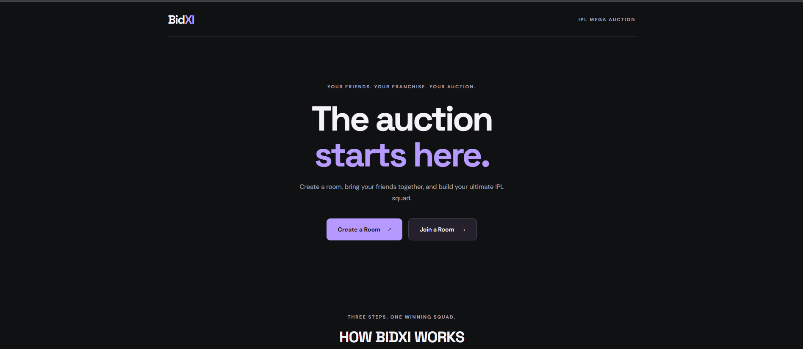
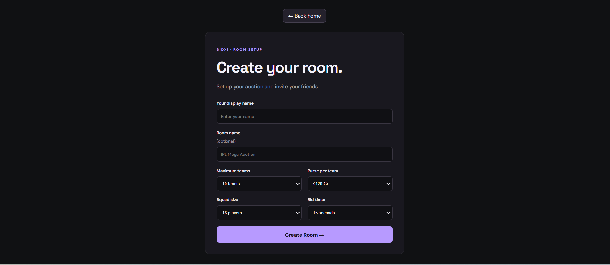
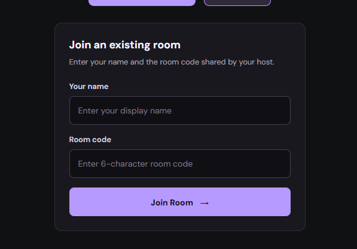
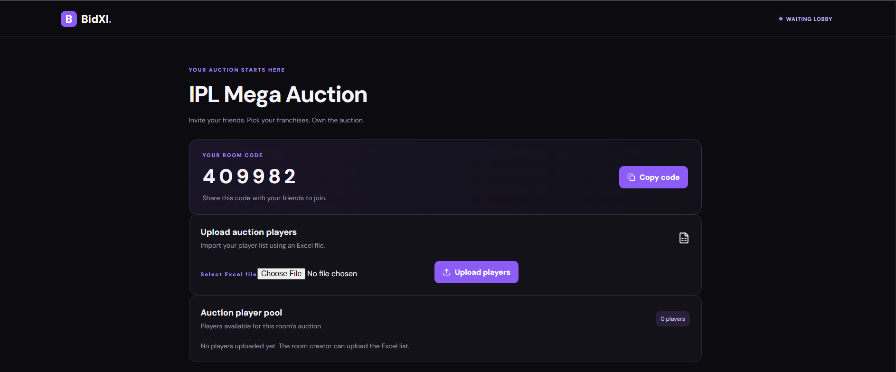
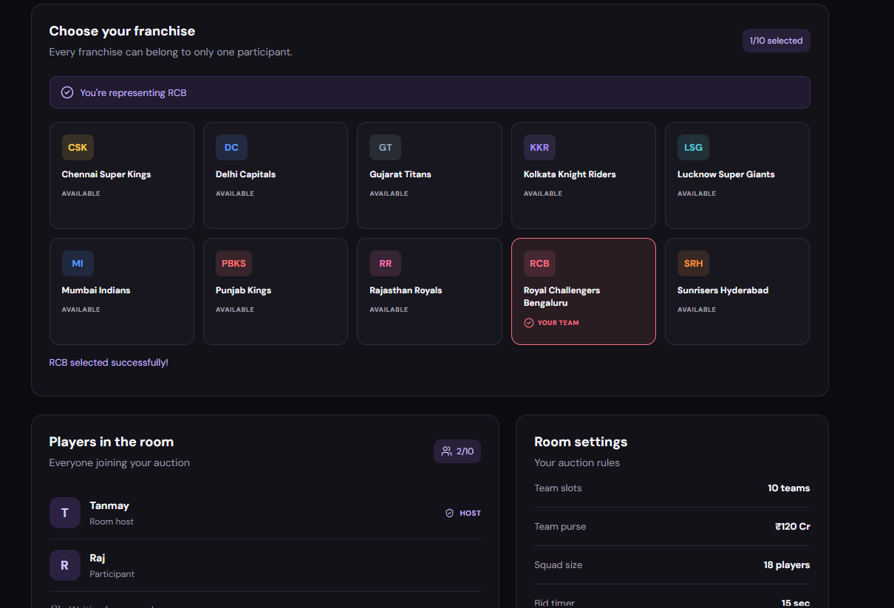
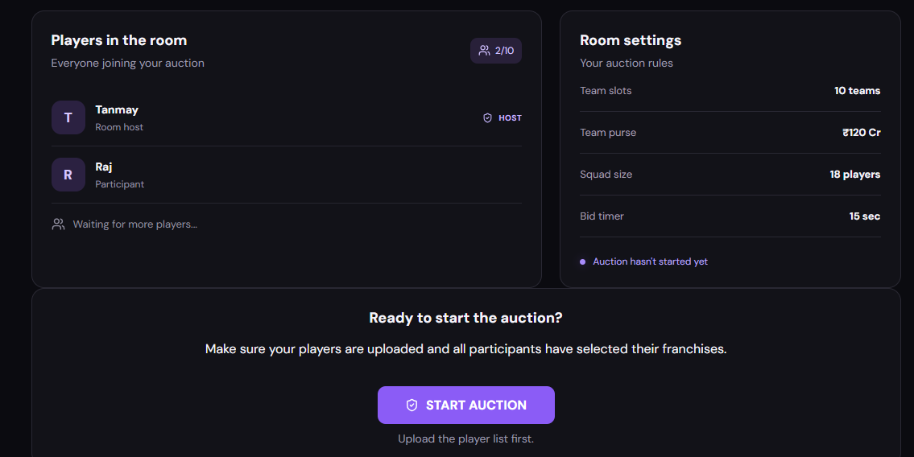
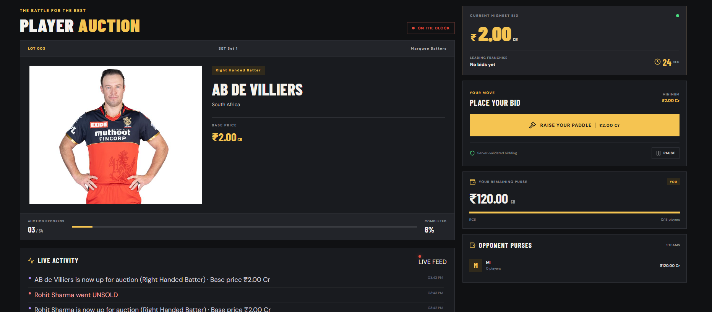
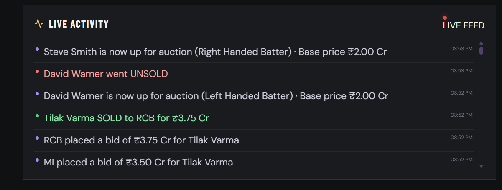
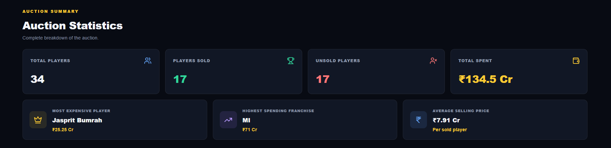
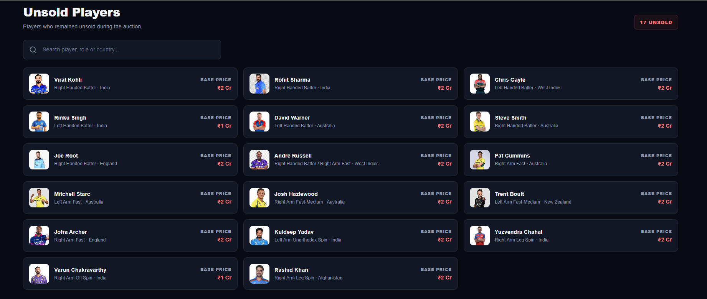

# 🏏 BidXI — Real-Time IPL Auction Platform

**Create rooms. Pick franchises. Bid for your dream IPL squad.**

BidXI is a multiplayer IPL auction platform where users can create private auction rooms, invite friends, select their favourite IPL franchises, and compete in a real-time bidding environment to build their dream squads.

Inspired by the excitement of the IPL player auction, BidXI brings the auction experience to friends through room-based participation, live bidding, and squad building.

---

## 📸 Website Screenshots

### 🏠 Home Page


### 🏗️ Create Room


### 🚪 Join Room


### 👥 Room Page


### 🏏 Team Selection


### 🎯 Start Auction


### 🔨 Live Auction


### 📊 Auction Activity


### 🏆 Auction Summary


### 🧢 Final Squad


### Unsold Players


---

## ✨ Features

- **Create Auction Rooms:** Create private auction rooms and invite friends.
- **Join Rooms:** Join an existing room using a unique room code.
- **Franchise Selection:** Participants can select their preferred IPL franchise.
- **Real-Time Communication:** Socket.IO enables communication between participants in an auction room.
- **Live Bidding:** Participate in competitive player bidding.
- **Player Profiles:** View player details and images during the auction.
- **Auction Activity:** Track auction events and bidding activity.
- **Auction Summary:** View auction results and squad information.
- **Final Squad:** Review the squad built during the auction.
- **Unsold Players:** View players who remained unsold.

---

## 🛠️ Tech Stack

| Category | Technologies |
|---|---|
| Frontend | React.js, JavaScript, CSS |
| Backend | Node.js, Express.js |
| Real-Time Communication | Socket.IO |
| Routing | React Router |
| Development Tools | Vite, npm |

---

## ⚙️ How It Works

1. **Create or Join a Room:** Users create an auction room or join an existing room using a room code.
2. **Select a Franchise:** Participants choose their preferred IPL franchise.
3. **Enter the Auction:** The host starts the auction once the participants are ready.
4. **Real-Time Bidding:** Participants compete to acquire players through live bidding.
5. **Build Your Squad:** Each participant builds their squad while managing their auction budget.
6. **Review Results:** Participants can view the auction summary, final squads, and unsold players.

---

## 📁 Project Structure

```text
BidXI/
│
├── client/
│   ├── public/
│   │   └── images/
│   ├── src/
│   │   ├── components/
│   │   ├── pages/
│   │   ├── App.jsx
│   │   ├── App.css
│   │   └── main.jsx
│   └── package.json
│
├── server/
│   ├── src/
│   │   ├── config/
│   │   ├── controllers/
│   │   ├── models/
│   │   ├── routes/
│   │   ├── services/
│   │   ├── app.js
│   │   └── server.js
│   └── package.json
│
├── website_image/
│   ├── home_page.png
│   ├── create_room.png
│   ├── join_room.png
│   ├── room_page.png
│   ├── team_selection.png
│   ├── start_auction.png
│   ├── auction_page.png
│   ├── activity.png
│   ├── auction_summary.png
│   ├── final_squad.png
│   └── unsold_player.png
│
├── .gitignore
└── README.md
```

---

## 🚀 Getting Started

### Prerequisites

- Node.js
- npm
- Git

### 1. Clone the Repository

```bash
git clone https://github.com/TanmayShelar43/BidXI.git
cd BidXI
```

### 2. Setup the Backend

Navigate to the server directory:

```bash
cd server
npm install
```

Create a `.env` file inside the `server` directory and configure the required environment variables.

Start the backend:

```bash
npm run dev
```

### 3. Setup the Frontend

Open a new terminal from the project root:

```bash
cd client
npm install
```

Start the frontend:

```bash
npm run dev
```

Open the local URL displayed by Vite in your browser.

---

## 🎯 Project Goal

BidXI aims to recreate the excitement and strategy of an IPL player auction in a multiplayer environment.

The platform combines room-based participation, real-time communication, and competitive bidding to create an interactive auction experience for cricket fans.

---

## 👨‍💻 Author

**Tanmay Shelar**

- GitHub: [@TanmayShelar43](https://github.com/TanmayShelar43)
- Repository: [BidXI](https://github.com/TanmayShelar43/BidXI)

---

<p align="center">
  Made with ❤️ for cricket and technology.
</p>
